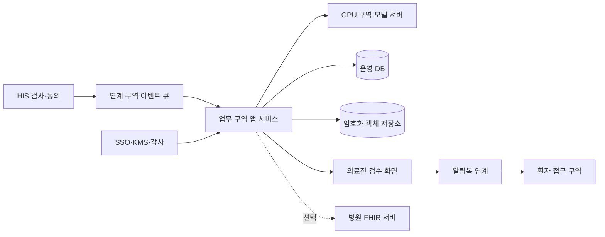

# 알레르기 검사 결과 안내 연구 의료정보센터 협조 요청서

이 문서는 병원 내부 운영 기반 구축을 요청합니다.

> 경고: IRB 승인 전에는 대상자를 등록하거나 결과를 보내지 마십시오.

> 경고: 의료진 승인 전에는 보고서, 카드, PDF, FHIR를 배포하지 마십시오.

작성일: 2026-10-29  
대상: 의료정보센터, 정보보호팀, 진료정보팀, 연구팀  
상태: 협의 초안  
범위: 설계·인프라·연계 협조 요청  
제외: 운영 배포와 실제 환자 데이터 처리

IRB 연계 기준은 v0.2 변경 초안입니다.  
만족도 설문 정의는 v0.1입니다.

## 1. 요청 결론

병원 승인 내부 서버에서 전 과정을 운영해 주십시오.

DGX Spark의 저장 모델을 센터 관리 GPU로 이전해 주십시오.

저장소의 모델 라벨은 `qwen3.8:27b`입니다.

이 라벨을 공식 모델 ID로 간주하지 마십시오.

연구팀은 원본 모델 위치와 라이선스를 제출해야 합니다.

환자 처리 경로에서는 외부 OpenAI 폴백을 차단해 주십시오.

HIS는 동의 후 검사 결과 이벤트만 큐에 넣어야 합니다.

병원 서버는 문진 완료 콜백을 받아야 합니다.

의료진은 모든 생성물을 검토하고 발송을 승인해야 합니다.

기본 전달 방식은 인증된 PDF 다운로드 URL입니다.

PDF 직접 첨부는 보안 검토 후에만 허용합니다.

FHIR 전송은 병원 합의가 있을 때만 추가합니다.

사후 만족도 설문은 임상 문진과 별도로 운영합니다.

## 2. IRB 경계

`docs/irb_2026-10-29/study_config.json`은 초안입니다.

제안 대상자는 성인 90명과 소아 30명입니다.

이 수치는 승인 전 계획값입니다.

제안 연구 기간은 24개월입니다.

제안 보존 기간은 연구 종료 후 3년입니다.

병원 정책과 IRB 결정이 제안값보다 우선합니다.

소아는 법정대리인 동의 절차가 필요합니다.

연령별 본인 동의 기준은 별도로 확정해야 합니다.

## 3. 현재 구현과 한계

| 영역 | 현재 구현 | 운영 한계 | 근거 |
|---|---|---|---|
| 웹 서비스 | FastAPI API와 정적 화면 | 병원 HA 구성 없음 | `server.py` |
| OCR | 전처리, 회전, 이중 판독 | HIS 이벤트 수신 없음 | `services/ocr_service.py` |
| AI 백엔드 | OpenAI와 Ollama 선택 | 외부 폴백 차단 없음 | `services/llm_backend.py` |
| 문진 | 문진 API와 분류 | 병원 콜백 없음 | `services/questionnaire_service.py` |
| 생성물 | 보고서, 카드, PDF | 임상 배포 승인 없음 | 보고서 서비스 |
| FHIR | 번들 생성 | 병원 전송 검증 없음 | `services/fhir_service.py` |
| 저장 | SQLite 두 파일 | 운영 DB와 백업 없음 | `services/store_service.py` |
| 전달 | SMTP 이메일 | 알림톡 연계 없음 | `services/email_service.py` |
| 관리자 | 서명 쿠키와 원점 검사 | 병원 SSO 없음 | `services/admin_api.py` |
| 만족도 설문 | 로컬 HTML 미리보기 | 원격 발송과 병원 API 없음 | `docs/patient_satisfaction_2026-10-29/` |

현재 큐, 알림톡, 임상 검수는 준비됐다고 가정하지 않습니다.

현재 PDF URL은 세션 ID를 접근 키처럼 사용합니다.

이 방식은 환자 본인 확인을 대체하지 못합니다.

배포 문서 일부는 현재 코드와 다릅니다.

문서는 무상태와 OpenAI 전용을 설명합니다.

현재 코드는 SQLite와 Ollama도 사용합니다.

## 4. 목표 구조



HIS 구역은 검사 결과의 기준 시스템 후보입니다.

동의의 기준 시스템은 병원 협의로 확정합니다.

연계 구역은 이벤트 중복과 재시도를 관리합니다.

GPU 구역은 승인 모델만 실행합니다.

환자 접근 구역은 내부 업무망과 분리합니다.

알림톡 사업자 연결은 지정된 송신 게이트웨이만 사용합니다.

## 5. 네트워크 협조

의료정보센터는 구역별 DNS 이름을 배정해 주십시오.

TLS 인증서 발급과 자동 갱신 방법을 정해 주십시오.

프록시가 신뢰할 원본 CIDR을 명시해 주십시오.

외부에서 전달한 `Forwarded` 헤더를 삭제해 주십시오.

방화벽은 필요한 목적지와 포트만 허용해 주십시오.

GPU 서버는 인터넷 기본 경로를 갖지 않게 해 주십시오.

환자 외부 웹은 별도 DMZ 경계에서 운영합니다.

환자 웹의 외부 접속 허용과 GPU 인터넷 차단을 구분합니다.

외부 요청은 DMZ ingress에서 인증하고 내부 API로 전달합니다.

내부 API는 문진을 병원 서버에 수신합니다.

병원 서버는 결과와 문진을 결합해 검수를 요청합니다.

승인된 검수 결과만 생성과 전달 단계로 이동합니다.

패키지 반입은 승인된 미러나 오프라인 저장소를 사용합니다.

| 출발 | 도착 | 목적 | 포트 | 결정 |
|---|---|---|---|---|
| 연계 서버 | 앱 API | 결과 이벤트 |  |  |
| 앱 API | GPU API | OCR·생성 |  |  |
| 앱 API | DB | 상태 저장 |  |  |
| 앱 API | 객체 저장소 | PDF·카드 저장 |  |  |
| 환자 웹 | 인증 서비스 | 본인 확인 |  |  |
| 송신 게이트웨이 | 사업자 | 알림톡 |  |  |

## 6. GPU와 모델 이전

연구팀은 정확한 모델 산출물을 제출해야 합니다.

다음 항목이 없으면 반입을 중단해 주십시오.

- 공식 저장소 또는 내부 원본 경로
- 정확한 모델 ID와 리비전
- 가중치와 설정 파일 SHA-256
- 라이선스와 사용 제한
- 양자화 방식과 정밀도
- 토크나이저와 채팅 템플릿
- 최대 컨텍스트 설정
- 런타임과 드라이버 버전
- 프롬프트와 후처리 버전

센터 GPU에서 VRAM을 직접 측정해 주십시오.

동시 요청 수와 지연 시간도 직접 측정해 주십시오.

측정 전에는 GPU 수량을 확정하지 마십시오.

모델 레지스트리는 승인과 운영 상태를 분리합니다.

롤백은 모델, 프롬프트, 파서 세트를 함께 되돌립니다.

환자 경로에는 OpenAI 자격 증명을 넣지 마십시오.

내부 모델이 실패하면 해당 작업을 보류합니다.

외부 API로 우회하거나 재전송하지 않습니다.

## 7. HIS 결과 이벤트

HIS는 유효한 연구 동의를 먼저 확인합니다.

구조화 검사 결과가 있으면 OCR보다 직접 연계를 우선합니다.

원본 PDF와 사진은 대조와 감사 목적으로 보존합니다.

각 값은 출처, 원문, 단위, 결과 버전을 포함합니다.

OCR 값은 구조화 값의 자동 대체값으로 사용하지 않습니다.

그 후 결과 이벤트를 내구성 큐에 기록합니다.

중복 키는 `source_system + event_id`입니다.

결과 의미 키는 `test_result_ref + result_version`입니다.

```json
{
  "schema": "his_result_event_v1",
  "event_id": "EVT-EXAMPLE-0001",
  "source_system": "HIS-TEST",
  "study_subject_ref": "SUBJ-EXAMPLE-0001",
  "consent_version": "IRB-VERSION-PENDING",
  "test_result_ref": "RESULT-EXAMPLE-0001",
  "result_version": 2,
  "test_type": "SPT",
  "status": "final"
}
```

직접 식별자는 이벤트에 넣지 마십시오.

환자 매핑은 병원 내부 토큰 저장소에서 수행합니다.

MAST, SPT, UniCAP 또는 ImmunoCAP을 구분합니다.

단위, 검출한계, 반응 등급을 원문대로 보존합니다.

SPT는 팽진 크기와 대조군 값을 함께 보존합니다.

정정 결과는 기존 버전을 덮어쓰지 않습니다.

미발송 생성물은 새 결과로 무효화합니다.

이미 발송한 결과는 정정 절차를 시작합니다.

## 8. 동의와 철회 경합

발송 직전에 동의 상태를 다시 읽으십시오.

철회가 확인되면 신규 생성과 재시도를 중단하십시오.

이미 사업자에 접수된 메시지는 취소 가능성을 확인합니다.

취소할 수 없으면 접수 상태를 그대로 기록합니다.

철회 시각과 발송 잠금 시각을 모두 보존합니다.

경합 결과를 사람이 재검토할 수 있게 표시합니다.

## 9. 문진 콜백

병원 서버는 응답 리비전을 받아야 합니다.

```json
{
  "schema": "questionnaire_callback_v1",
  "questionnaire_instance_id": "Q-EXAMPLE-0001",
  "study_subject_ref": "SUBJ-EXAMPLE-0001",
  "result_version": 2,
  "response_revision": 1,
  "status": "submitted",
  "guardian_mode": false,
  "answers": {"Q1": "example-choice"}
}
```

중복 키는 문진 ID와 응답 리비전입니다.

콜백은 상호 TLS 또는 서명 토큰을 사용합니다.

철회 후 콜백은 보관 정책에 따라 거부하거나 격리합니다.

## 10. 의료진 검수

생성 상태와 배포 상태를 분리하십시오.

상태는 `draft`, `review`, `approved`, `sent`를 사용합니다.

거절 상태는 `rejected`로 별도 기록합니다.

승인은 산출물 해시와 리비전에 결합합니다.

결과나 문진이 바뀌면 기존 승인을 무효화합니다.

검수자는 병원 SSO로 로그인합니다.

검수자는 검사값, 단위, 대조군, 문진을 확인합니다.

검수자는 환자와 수신자 연결도 확인합니다.

최종 승인은 하나의 트랜잭션으로 기록합니다.

승인은 파일 해시와 검사 버전을 결합합니다.

승인은 문진 버전과 동의 상태도 결합합니다.

승인은 최종 수신자 확인 결과도 결합합니다.

같은 트랜잭션이 발송 아웃박스 행을 생성합니다.

발송 작업자는 아웃박스 커밋 후 큐에 게시합니다.

소비자는 DB 커밋 후에만 큐 ACK를 반환합니다.

전달 ID의 고유 제약이 중복 발송을 차단합니다.

ACK 유실 시 같은 전달 ID로 안전하게 재처리합니다.

## 11. 알림톡과 환자 전달

기본 메시지는 만료되는 보안 URL을 포함합니다.

URL은 원본 세션 ID를 노출하지 않습니다.

접근 시 환자 본인 확인을 수행합니다.

소아는 등록된 보호자 관계를 확인합니다.

카드 URL은 PDF와 같은 승인 리비전을 사용합니다.

직접 PDF 첨부는 조건 충족 후에만 허용합니다.

사업자는 발신 프로필과 템플릿을 승인해야 합니다.

웹훅은 공급자 이벤트 ID로 중복 제거합니다.

실패는 지수형 재시도 정책으로 처리합니다.

최대 재시도 후 데드레터 큐로 이동합니다.

재시도 횟수와 기간은 병원 정책으로 확정합니다.

발송 영수증과 최종 상태를 저장합니다.

## 11.1 사후 만족도 설문

이 설문은 임상 문진 알림과 별도로 보냅니다.

설문 참여 동의를 받은 대상자에게만 보냅니다.

설문은 약 2분을 목표로 합니다.

실제 소요 시간은 예비 조사에서 확인합니다.

다음 6문항을 그대로 사용합니다.

1. 글과 화면을 보기 쉬웠습니다.
2. 검사 결과의 설명을 이해하기 쉬웠습니다.
3. 생활에서 주의할 점을 이해하는 데 도움이 됐습니다.
4. 휴대전화에서 결과 자료를 확인하기 편리했습니다.
5. 결과 자료를 필요한 시점에 받았습니다.
6. 전반적으로 이 결과 안내 서비스에 만족합니다.

응답은 5점 척도와 평가하기 어려움을 제공합니다.

응답하지 않음도 별도 값으로 보존합니다.

선택 의견은 최대 300자로 받습니다.

이름, 전화번호와 자세한 건강정보는 적지 않게 안내합니다.

응답은 가명 연구번호와 등록 검사 회차로 연결합니다.

새 직접 식별자는 설문에서 받지 않습니다.

보호자 응답은 환자 본인 응답과 나누어 분석합니다.

문항별 분포, 유효 응답 수와 중앙값을 산출합니다.

사분위 범위도 함께 산출합니다.

주 분석은 6번 문항의 4점과 5점 비율입니다.

분모는 6번 문항에 1점부터 5점으로 답한 수입니다.

평가하기 어려움, 건너뜀과 공란은 분모에서 뺍니다.

합산 점수는 만들지 않습니다.

만족도는 임상 정확성이나 치료 효과를 증명하지 않습니다.

### 초대 조건과 일정

승인 자료의 실제 수령 확인 뒤 24시간 후 초대합니다.

수령 확인은 인증 열람 기록을 우선 사용합니다.

연구자가 직접 확인한 수령 기록도 사용할 수 있습니다.

사업자 발송 영수증만으로 수령이나 읽음을 단정하지 않습니다.

응답 기간은 초대 후 7일입니다.

미응답이면 초대 3일 뒤 한 번만 다시 알립니다.

검사 결과 확정 뒤 30일을 참여 상한으로 둡니다.

만료 시각은 두 기한 중 이른 시각입니다.

초대 시 남은 시간이 24시간 미만이면 보내지 않습니다.

### 상태와 중복 차단

중복 키는 연구대상자, 등록 회차와 설문 버전입니다.

보고서 정정 중에는 설문 예약을 보류합니다.

이미 초대한 회차에는 정정 후 자동 초대하지 않습니다.

철회가 확인되면 예약, 초대와 재알림을 중단합니다.

소아는 확인된 보호자에게만 설문을 보냅니다.

이미 응답한 대상자에게 재알림을 보내지 않습니다.

메시지 전달 웹훅과 보고서 접근 기록을 구분합니다.

설문 서버 콜백은 응답 버전과 제출 상태를 포함합니다.

연구자는 동의와 분석 기준을 관리합니다.

의료정보센터는 상태, 중복과 콜백을 관리합니다.

메시지 담당자는 초대와 재알림 영수증을 관리합니다.

현재 원격 환자 발송과 병원 API는 구현하지 않았습니다.

현재 HTML은 로컬 미리보기이며 네트워크 제출을 하지 않습니다.

설문 자료는 다음 문서로 연결합니다.

- [환자용 설문 미리보기](../patient_satisfaction_2026-10-29/patient_satisfaction.html)
- [구현 안내](../patient_satisfaction_2026-10-29/implementation_guide.html)

## 12. 인증과 계정

사람 계정은 병원 SSO를 사용합니다.

역할은 연구자, 검수자, 운영자, 감사자로 나눕니다.

HIS, 앱, GPU, 메시지, 백업 계정을 분리합니다.

서비스 계정은 대화형 로그인을 금지합니다.

비밀은 코드와 환경 파일에 저장하지 않습니다.

KMS 또는 병원 비밀 저장소를 사용합니다.

키 회전과 폐기 기록을 남깁니다.

## 13. 데이터와 보존

운영 상태는 병원 관리 DB에 저장합니다.

PDF와 카드 파일은 암호화 객체 저장소에 둡니다.

DB와 객체는 KMS 관리 키로 암호화합니다.

백업도 별도 키와 접근 권한을 사용합니다.

복구 시점과 복구 시간 목표를 센터가 정합니다.

운영 전 복구 훈련을 수행합니다.

보존 기간은 IRB와 병원 정책으로 확정합니다.

삭제는 DB, 객체, 백업 만료를 함께 다룹니다.

## 14. 로그와 모니터링

로그에 이름, 차트번호, 전화번호를 넣지 마십시오.

검사값과 문진 답변도 일반 로그에서 제외합니다.

로그는 내부 추적 ID와 상태 코드만 사용합니다.

감사 로그는 조회, 승인, 발송, 철회를 기록합니다.

메트릭은 큐 지연, 오류율, GPU 사용량을 포함합니다.

오류 메시지의 건강정보 누출을 자동 검사합니다.

## 15. 중단 기준

잘못된 환자에게 보낼 가능성이 있으면 발송을 중단합니다.

동의가 없거나 철회 상태면 발송을 중단합니다.

미승인 생성물이면 발송을 중단합니다.

결과 버전이 다르면 발송을 중단합니다.

모델 해시가 다르면 생성을 중단합니다.

외부 전송 시도가 감지되면 환자 처리를 중단합니다.

감사 로그가 유실되면 신규 발송을 중단합니다.

## 16. RACI

R은 실행 책임자입니다.

A는 최종 승인 책임자입니다.

C는 사전 협의 대상입니다.

I는 결과 공유 대상입니다.

| 업무 | 연구책임자 | 의료정보센터 | 정보보호팀 | 의료진 검수자 | 메시지 담당 |
|---|---|---|---|---|---|
| IRB 범위 | A | C | C | R | I |
| HIS 연계 | C | A/R | C | I | I |
| GPU·모델 | C | A/R | C | I | I |
| SSO·권한 | I | R | A | C | I |
| 임상 검수 | A | C | I | R | I |
| 알림톡 | C | R | C | I | A/R |
| 만족도 설문 | A | R | C | C | R |
| 장애 대응 | C | A/R | R | C | R |
| 중단 결정 | A | R | R | R | C |

## 17. 요청 티켓

| ID | 요청 | 담당 | 완료 증거 |
|---|---|---|---|
| MI-NET | DNS, TLS, 프록시, 방화벽 | 의료정보센터 | 승인 도면과 시험 |
| MI-IAM | SSO, 역할, 서비스 계정 | 정보보호팀 | 권한표와 접근 시험 |
| MI-GPU | 모델 반입과 성능 측정 | 인프라팀 | 모델 카드와 측정표 |
| MI-HIS | 동의와 결과 이벤트 | 진료정보팀 | 큐 통합 시험 |
| MI-QNR | 문진 콜백 | 의료정보센터 | 콜백 시험 |
| MI-REV | 검수와 배포 승인 | 연구팀 | 차단 시험 |
| MI-MSG | 알림톡과 보안 URL | 메시지 담당 | 샌드박스 영수증 |
| MI-DATA | DB, 객체, 백업 | 의료정보센터 | 복구 훈련 |
| MI-OPS | 로그와 경보 | 운영팀 | 장애 훈련 |
| MI-FHIR | 선택형 FHIR | 진료정보팀 | 프로파일 검증 |
| MI-SAT | 사후 만족도 설문 상태와 콜백 | 의료정보센터 | 일정·중복·철회 시험 |

## 18. 단계별 인수 기준

1단계는 설계와 IRB 경계를 확정합니다.

증거는 승인 도면, 데이터 목록, 책임표입니다.

2단계는 내부 GPU와 오프라인 설치를 검증합니다.

증거는 해시, SBOM, 성능 측정, 롤백 기록입니다.

3단계는 HIS, 문진, 검수 연계를 시험합니다.

증거는 중복, 정정, 철회, 미승인 차단 기록입니다.

4단계는 알림톡 샌드박스를 검증합니다.

증거는 성공, 실패, 웹훅, 데드레터 기록입니다.

만족도 초대와 임상 문진 메시지를 구분해 시험합니다.

증거는 수령 확인, 일정, 중복과 유효 분모 기록입니다.

5단계는 비식별 통합 훈련을 수행합니다.

증거는 복구, 보안, 오발송 중단 훈련 기록입니다.

6단계는 승인 후 제한 운영을 시작합니다.

IRB, 보안, 운영 책임자가 모두 서명해야 합니다.

## 19. 가동 승인 조건

- IRB 승인 문서와 버전이 일치한다.
- 보안성 검토가 완료됐다.
- 환자·보호자 본인 확인 시험이 통과했다.
- 잘못된 환자 시나리오가 발송을 차단했다.
- 철회 경합 시험이 통과했다.
- 모델 롤백과 DB 복구 훈련이 통과했다.
- 사업자 웹훅과 데드레터 시험이 통과했다.
- 외부 OpenAI 전송 차단이 증명됐다.
- 만족도 설문의 일정과 중복 차단 시험이 통과했다.

## 20. 자원과 비용 기입란

| 항목 | 값 | 근거 |
|---|---|---|
| 일일 검사량 |  |  |
| 피크 시간 검사량 |  |  |
| GPU 종류와 수량 |  |  |
| 실측 VRAM |  |  |
| 실측 동시 처리량 |  |  |
| 연간 저장 증가량 |  |  |
| 백업 보존 |  |  |
| 알림톡 단가 |  |  |
| 인프라 비용 |  |  |
| 운영 인력 |  |  |

실측과 공식 견적 전에는 값을 채우지 않습니다.

## 21. 비차단 질문

### 의료정보센터

- 표준 배포 구역과 프록시는 무엇입니까?
- 운영 DB와 객체 저장소 표준은 무엇입니까?
- 오프라인 패키지 반입 절차는 무엇입니까?
- 백업 목표와 복구 훈련 주기는 무엇입니까?

### 정보보호팀

- 환자 웹 본인 확인 수단은 무엇입니까?
- 소아 보호자 관계는 어디서 확인합니까?
- 서비스 계정과 KMS 표준은 무엇입니까?
- 로그 보존과 감사 범위는 무엇입니까?

### 진료정보팀

- 동의와 철회의 기준 시스템은 무엇입니까?
- 결과 정정과 취소는 어떤 이벤트로 보냅니까?
- MAST, SPT, UniCAP 단위 표준은 무엇입니까?
- 환자 FHIR 다운로드가 필요한 목적은 무엇입니까?
- 병원 FHIR 서버 전송이 필요한 목적은 무엇입니까?

### 메시지 담당

- 병원 알림톡 사업자와 발신 프로필은 무엇입니까?
- URL 만료와 재발급 정책은 무엇입니까?
- 직접 PDF 첨부를 사업자가 지원합니까?
- 영수증 웹훅과 재시도 계약은 무엇입니까?
- 임상 문진과 만족도 설문 템플릿을 어떻게 구분합니까?

### 연구팀

- `qwen3.8:27b`의 정확한 원본은 무엇입니까?
- 모델 라이선스와 SHA-256은 무엇입니까?
- 승인할 프롬프트와 파서 버전은 무엇입니까?
- 의료진 검수 책임자는 누구입니까?
- 만족도 설문의 동의와 유효 응답 기준은 무엇입니까?

## 22. 저장소 근거

이 요청서는 현재 저장소를 정적으로 검토했습니다.

검토 커밋은 `2aa3fbf29cd0afd3e06029aa12e6fcf90f9c6a98`입니다.

주요 근거는 다음 파일입니다.

- `server.py`
- `config/settings.py`
- `services/llm_backend.py`
- `services/ocr_service.py`
- `services/store_service.py`
- `services/questionnaire_service.py`
- `services/fhir_service.py`
- `services/email_service.py`
- `services/admin_api.py`
- `services/report_pdf.py`
- `Dockerfile`
- `requirements.txt`
- `docs/irb_2026-10-29/study_config.json`

이 문서는 코드 변경이나 운영 승인을 의미하지 않습니다.

## 부록 A. 최소 인터페이스 계약

모든 인터페이스는 스키마 버전을 포함합니다.

모든 시각은 시간대를 포함한 ISO 8601 형식을 사용합니다.

모든 요청은 내부 추적 ID를 포함합니다.

추적 ID는 환자 식별자로 사용하지 않습니다.

오류 응답은 건강정보를 반환하지 않습니다.

### A.1 결과 상세 예시

```json
{
  "schema": "allergy_result_v1",
  "test_result_ref": "RESULT-EXAMPLE-0001",
  "result_version": 2,
  "test_type": "SPT",
  "controls": {
    "histamine_mean_mm": 4.0,
    "saline_mean_mm": 0.0
  },
  "items": [
    {
      "item_code": "EXAMPLE-ALLERGEN-01",
      "size_text": "3x4 mm",
      "mean_mm": 3.5,
      "unit": "mm"
    }
  ]
}
```

`size_text`는 인쇄 원문을 보존합니다.

`mean_mm`는 파생 규칙과 버전을 함께 기록합니다.

MAST는 수치와 등급을 각각 보존합니다.

검출한계 표기는 수치 0으로 바꾸지 않습니다.

UniCAP 또는 ImmunoCAP은 보고 단위를 보존합니다.

### A.2 검수 결정 예시

```json
{
  "schema": "clinical_release_v1",
  "artifact_set_id": "ART-EXAMPLE-0001",
  "artifact_revision": 3,
  "decision_revision": 1,
  "decision": "approved",
  "reviewer_role": "allergy_clinician",
  "result_version": 2,
  "questionnaire_revision": 1,
  "artifact_sha256": "EXAMPLE-NOT-A-REAL-HASH"
}
```

검수 API는 검수자 이름을 메시지 사업자에 보내지 않습니다.

감사 시스템만 검수자 병원 계정을 보관합니다.

### A.3 전달 요청 예시

```json
{
  "schema": "delivery_request_v1",
  "delivery_id": "DEL-EXAMPLE-0001",
  "artifact_set_id": "ART-EXAMPLE-0001",
  "artifact_revision": 3,
  "channel": "alimtalk",
  "recipient_binding_ref": "RECIPIENT-EXAMPLE-0001",
  "template_id": "TEMPLATE-PENDING",
  "link_id": "LINK-EXAMPLE-0001"
}
```

수신자 전화번호는 별도 보호 저장소에서 결합합니다.

큐 메시지에는 전화번호를 넣지 않는 방식을 우선합니다.

### A.4 전달 상태 웹훅 예시

```json
{
  "schema": "delivery_status_webhook_v1",
  "provider": "PROVIDER-PENDING",
  "provider_event_id": "PEVT-EXAMPLE-0001",
  "provider_message_id": "PMSG-EXAMPLE-0001",
  "delivery_id": "DEL-EXAMPLE-0001",
  "status": "delivered",
  "occurred_at": "2026-01-01T00:00:00+09:00"
}
```

웹훅 서명은 원문 바이트 기준으로 검증합니다.

허용 시간 차이와 재전송 기준을 계약서에 적습니다.

알 수 없는 상태는 성공으로 변환하지 않습니다.

## 부록 B. 상태 전이 규칙

| 대상 | 시작 | 허용 다음 상태 | 금지 예시 |
|---|---|---|---|
| 동의 | pending | active, declined | declined에서 active 자동 전환 |
| 동의 | active | withdrawn, expired | withdrawn 뒤 발송 |
| 결과 | preliminary | final, corrected | final 결과 덮어쓰기 |
| 생성물 | draft | review, invalidated | draft 발송 |
| 생성물 | review | approved, rejected | 미검수 승인 |
| 전달 | queued | accepted, failed | 철회 뒤 재시도 |
| 전달 | accepted | delivered, failed, unknown | unknown을 delivered 처리 |

상태 전이는 단일 트랜잭션으로 기록합니다.

상태와 감사 이벤트를 함께 기록합니다.

중복 요청은 기존 결과를 반환합니다.

순서가 뒤집힌 이벤트는 격리 큐로 보냅니다.

운영자는 격리 이유와 해제 결정을 기록합니다.

## 부록 C. 시험 증거표

| 시험 ID | 시나리오 | 기대 결과 | 증거 소유자 |
|---|---|---|---|
| T01 | 같은 HIS 이벤트 3회 | 1회 처리 | 진료정보팀 |
| T02 | 결과 버전 2 뒤 버전 1 | 버전 1 격리 | 진료정보팀 |
| T03 | 발송 직전 철회 | 발송 없음 | 연구팀 |
| T04 | 사업자 접수 뒤 철회 | 재시도 중단과 기록 | 메시지 담당 |
| T05 | 미승인 PDF 요청 | 403 또는 동등 차단 | 앱 운영팀 |
| T06 | 타인 링크 사용 | 접근 거부 | 정보보호팀 |
| T07 | 만료 링크 재사용 | 접근 거부 | 정보보호팀 |
| T08 | 보호자 관계 종료 | 소아 접근 거부 | 정보보호팀 |
| T09 | 모델 체크섬 불일치 | 생성 중단 | GPU 운영팀 |
| T10 | 외부 DNS 요청 | 네트워크 차단 | 의료정보센터 |
| T11 | DB 장애 | 큐 보존과 발송 중단 | 운영팀 |
| T12 | 객체 저장소 장애 | 승인 유지와 발송 중단 | 운영팀 |
| T13 | 웹훅 중복 5회 | 상태 1회 반영 | 메시지 담당 |
| T14 | 웹훅 서명 오류 | 거부와 경보 | 정보보호팀 |
| T15 | 백업 복원 | 승인 목표 내 복구 | 의료정보센터 |
| T16 | 로그에 검사값 입력 | 마스킹 또는 차단 | 운영팀 |
| T17 | 잘못된 환자 연결 | 발송 차단과 중단 | 전 팀 |
| T18 | FHIR 프로파일 오류 | 전송 거부 | 진료정보팀 |
| T19 | 발송 영수증만 있고 열람 없음 | 만족도 초대 없음 | 메시지 담당 |
| T20 | 승인 자료 열람 뒤 24시간 경과 | 만족도 초대 1회 | 의료정보센터 |
| T21 | 초대 3일 뒤 미응답 | 재알림 1회 | 메시지 담당 |
| T22 | 이미 만족도 응답 완료 | 재알림 없음 | 의료정보센터 |
| T23 | 검사 확정 30일 상한까지 23시간 | 만족도 초대 없음 | 연구팀 |
| T24 | 보고서 정정 대기 | 만족도 예약 보류 | 연구팀 |
| T25 | 만족도 초대 전 철회 | 초대와 재알림 없음 | 연구팀 |
| T26 | 확인되지 않은 보호자 | 소아 만족도 접근 거부 | 정보보호팀 |
| T27 | 같은 대상자·회차·설문 버전 재요청 | 1회만 처리 | 의료정보센터 |

각 시험은 실행 시각과 환경 버전을 기록합니다.

각 시험은 입력 해시와 결과 로그를 연결합니다.

실패 시험은 수정 티켓과 재시험을 연결합니다.

## 부록 D. 오프라인 반입 목록

센터는 반입 전 목록을 승인해 주십시오.

- 컨테이너 이미지와 다이제스트
- Python 잠금 의존성과 해시
- 운영체제 패키지 목록
- SBOM과 취약점 검사 결과
- 모델 가중치와 설정 파일
- 폰트와 PDF 생성 의존성
- 데이터베이스 마이그레이션 파일
- 배포 설정 예시와 비밀 제외 확인
- 복구 스크립트와 운영 절차

오프라인 환경에서 처음부터 설치를 재현합니다.

설치자는 반입 파일 해시를 다시 확인합니다.

취약점 예외는 책임자와 만료일을 기록합니다.

### D.1 GPU 재현 및 부하 시험

| 항목 | 확인 값 | 합격 기준 | 증거 |
|---|---|---|---|
| 모델 원본 |  | 승인 원본과 일치 | 저장소와 리비전 |
| 라이선스 |  | 병원 사용 허용 | 라이선스 사본 |
| 가중치 해시 |  | 등록 SHA-256 일치 | 해시 기록 |
| 양자화 |  | 등록 방식 일치 | 런타임 설정 |
| 비전 입력 |  | 지원 형식 재현 | 대표 이미지 시험 |
| API 호환 |  | 요청·응답 스키마 일치 | 계약 시험 |
| 오프라인 설치 |  | 외부 연결 없이 성공 | 네트워크 차단 로그 |
| 컨텍스트 |  | 설정 한도 내 안정 | 경계값 시험 |
| VRAM |  | 실측값 기록 | GPU 메트릭 |
| 단일 지연 |  | 기준은 협의 후 기입 | p50·p95 측정 |
| 동시 처리 |  | 기준은 협의 후 기입 | 단계별 부하 시험 |
| 장시간 처리 |  | 누수와 중단 없음 | 지속 시험 |
| 장애 복구 |  | 보류 후 안전 재개 | 재시작 시험 |

`qwen3.8:27b`는 현재 저장 라벨로만 기록합니다.

공식 지원 여부는 원본과 라이선스 확인 전 판단하지 않습니다.

## 부록 E. FHIR 전달 방식 구분

환자 다운로드와 병원 서버 전송을 구분합니다.

환자 다운로드는 승인된 파일을 환자가 받는 기능입니다.

병원 전송은 FHIR 서버에 리소스를 기록하는 연계입니다.

두 기능은 인증, 동의, 감사 범위가 다릅니다.

병원 전송은 CapabilityStatement를 먼저 확인합니다.

병원 전송은 프로파일과 버전 정책을 합의합니다.

병원 전송은 `application/fhir+json`을 사용합니다.

환자 다운로드를 병원 FHIR 기록으로 간주하지 않습니다.

## 부록 F. 운영 인계 목록

운영 전 다음 문서를 인계합니다.

- 승인 네트워크 도면
- 서비스와 포트 목록
- 계정과 권한 목록
- 모델 레지스트리 항목
- 데이터 사전과 보존표
- 백업과 복구 절차
- 장애와 중단 절차
- 알림톡 사업자 계약 요약
- 검수자 교육 기록
- 변경과 롤백 절차
- 연락망과 당직 체계

운영 책임자는 인계 항목별 수령을 기록합니다.

미완료 항목은 가동 승인 예외로 처리하지 않습니다.

## 공식 참고 문서

- [카카오비즈니스 알림톡 안내](https://business.kakao.com/info/infotalk)
- [카카오디벨로퍼스 메시지 제품 구분](https://developers.kakao.com/docs/ko/kakaotalk-message/faq)
- [HL7 FHIR R4 보안](https://hl7.org/fhir/R4/security.html)
- [HL7 FHIR R4 RESTful API](https://hl7.org/fhir/R4/http.html)

카카오 공식 문서는 알림톡과 메시지 API를 구분합니다.

사업자 실제 API 계약은 선정 사업자 문서로 확정합니다.

FHIR R4는 보안 프로토콜 자체가 아닙니다.

병원은 인증, 권한, 감사, 동의를 별도로 적용해야 합니다.
